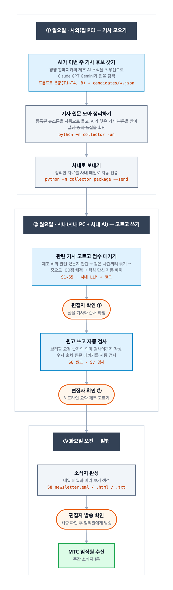
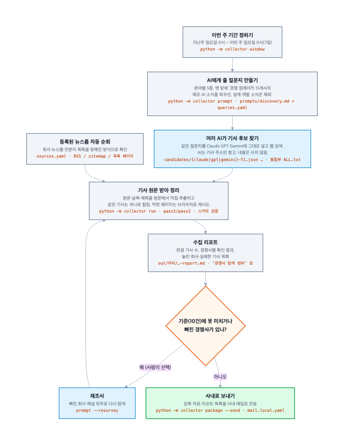
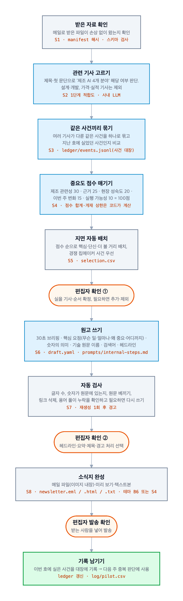

# MTC AX Tech Brief — 주간 소식지는 이렇게 만들어집니다

> MTC AX/PI팀이 매주 화요일 보내는 제조 AI 동향 소식지의 제작 과정을 소개합니다.
> 개발 지식이 없어도 읽을 수 있게 썼고, 개발 관련 세부 사항은 그림 속 **주황색 글씨**와 맨 아래 [개발자 참고](#개발자-참고)에 모았습니다.

## 한눈에 보기

| 언제 | 어디서 | 무엇을 | 사람이 하는 일 |
|---|---|---|---|
| **일요일** | 사외(집 PC) | AI가 이번 주 기사 후보를 찾고, 프로그램이 원문을 모아 정리해 사내로 보냅니다 | 자료가 부족할 때 다시 찾을지만 고릅니다 |
| **월요일** | 사내(사내 PC + 사내 AI) | 사내 AI가 관련 기사를 고르고, 중요도를 매기고, 원고를 씁니다 | 실을 기사를 확정하고(확인 ①), 헤드라인·제목을 고릅니다(확인 ②) |
| **화요일 오전** | 사내 | 소식지 메일을 완성합니다 | 마지막으로 확인하고 발송합니다 |

**그림 읽는 법**

| 상자 색 | 뜻 |
|---|---|
| 파란색 | AI가 하는 일(기사 찾기, 판단, 원고 쓰기) |
| 회색 | 프로그램이 정해진 규칙대로 자동으로 하는 일 |
| 주황 테두리(둥근 상자) | 사람(편집자)이 확인하고 고르는 일 |
| 초록색 | 결과물 |

상자 안의 **굵은 글씨**는 단계 이름, 회색 글씨는 쉬운 설명, 주황색 글씨는 개발자용 기술 정보입니다.

---

## 이 소식지가 다루는 것

- **가장 중요한 주제: 경쟁 칩메이커의 '제조 AI' 동향.** SK하이닉스, Micron, TSMC, Intel, GlobalFoundries, UMC, SMIC, Kioxia 등 15개사가 **팹(공장) 운영과 제조 현장에 AI·자동화를 어떻게 쓰는지**를 매주 빠짐없이 확인합니다.
- 함께 다루는 분야: 장비사, 제조 솔루션 기업, 팹에서 일하는 로봇(Physical AI).
- **다루지 않는 것:** 칩 설계, 신제품 개발·출시, AI 칩 판매, 실적·주가·가격. 경쟁사 소식이라도 설계·개발 이야기는 싣지 않습니다.

---

## ① 일요일 — 기사 모으기 (사외)

1. **이번 주 기간을 정합니다.** 지난주 일요일 0시부터 이번 주 일요일 0시까지, 7일간 나온 자료만 다룹니다.
2. **AI에게 줄 질문지를 만듭니다.** 분야별로 5개의 질문지를 만듭니다. 모든 질문지 맨 앞에 "경쟁 칩메이커의 제조 AI 소식을 최우선으로 찾되, 설계·개발 소식은 제외하라"는 지시가 들어갑니다. 칩메이커 질문지에는 15개사를 하나씩 확인하는 목록(공식 뉴스룸, 학회 발표, 현지 언어 매체 등)이 들어갑니다.
3. **여러 AI가 기사 후보를 찾습니다.** 같은 질문지를 Claude·GPT·Gemini에 그대로 넣고 웹을 검색하게 합니다. 여러 AI를 쓰면 한 AI가 놓친 기사를 다른 AI가 찾아 줍니다. **AI는 기사 주소만 찾고, 기사 내용은 쓰지 않습니다.**
4. **등록된 뉴스룸은 자동으로 돕니다.** 주요 회사 뉴스룸과 전문지는 프로그램이 정해진 방식으로 직접 확인합니다.
5. **기사 원문을 받아 정리합니다.** 프로그램이 원문 페이지에서 본문·날짜·제목을 직접 읽어 옵니다. 같은 기사는 하나로 합치고, 막힌 페이지는 브라우저로 한 번 더 시도합니다. 그래서 어떤 AI가 찾았든 정리된 결과는 같습니다.
6. **리포트를 확인합니다.** 모은 기사 수와 회사별 확인 결과가 나옵니다. 기준(10건)에 못 미치거나 확인이 빠진 경쟁사가 있으면, 사람이 '다시 찾기(재조사)'를 고를 수 있습니다.
7. **사내로 보냅니다.** 정리한 자료를 압축해 사내 메일로 자동 전송합니다.

## ② 월요일 — 고르고 쓰기 (사내)

1. **받은 자료를 확인합니다.** 메일로 온 파일이 손상 없이 왔는지 확인합니다.
2. **관련 기사를 고릅니다.** 사내 AI가 제목과 첫 문단을 읽고 '제조 AI' 분야에 맞는지 판단합니다.
3. **같은 사건끼리 묶습니다.** 여러 매체가 다룬 같은 사건은 하나로 묶고, 지난 호에 실었던 사건인지 비교합니다. 이미 실은 사건은 새로 바뀐 내용이 있을 때만 '후속'으로 싣습니다.
4. **중요도 점수를 매깁니다.** 100점 만점입니다.

   | 항목 | 배점 | 보는 것 |
   |---|---|---|
   | 제조 관련성 | 30 | 실제 반도체 제조 업무와 얼마나 직접 관련되는가 |
   | 근거 수준 | 25 | 회사 공식 발표·검증 결과인가, 언론 보도뿐인가 |
   | 현장 성숙도 | 20 | 이미 양산에 쓰는가, 실증 중인가, 계획인가 |
   | 이번 주 변화 | 15 | 이번 주에 새로 무엇이 바뀌었나 |
   | 실행 가능성 | 10 | 우리 팀이 확인할 지표·업무가 분명한가 |

5. **지면을 자동으로 배치합니다.** 점수가 높은 사건을 '이번 주 핵심', 그다음을 '단신'과 '더 볼 거리'로 배치합니다. **경쟁 칩메이커의 제조 AI 사건을 우선**합니다.
6. **편집자 확인 ①** — 실을 기사와 순서를 확정합니다. 필요하면 추가하거나 뺍니다.
7. **원고를 씁니다.** 사내 AI가 기사마다 다음을 씁니다.
   - 한 줄 핵심: 누가, 무엇을, 어떤 결과를 냈고 왜 중요한지
   - 요점 4가지: 무슨 일 · 얼마나 · 왜 중요 · 어디까지 확인됐나
   - 숫자의 의미: 무엇을 잰 숫자이고 왜 중요한지
   - 기술의 원래 이름: 예) 결함 원인 분석 AI 에이전트(Defect Agent)
   - 검색어: 링크 대신 원문을 찾을 수 있는 이름
8. **자동 검사를 합니다.** 글자 수, 숫자가 원문에 실제로 있는지, 원문 문장을 그대로 베끼지 않았는지, 링크가 섞이지 않았는지, 어려운 용어에 풀이가 붙었는지 확인합니다. 문제가 있으면 AI가 한 번 다시 쓰고, 그래도 남으면 편집자에게 경고로 보여 줍니다.
9. **편집자 확인 ②** — 헤드라인, 한 줄 요약, 기사 제목을 후보 중에서 고르고 경고를 처리합니다.

## ③ 화요일 오전 — 발행

1. **소식지를 완성합니다.** 메일 파일(이미지 포함), 미리 보기, 텍스트본을 만듭니다.
2. **편집자 발송 확인** — 받는 사람을 넣어 임직원에게 보냅니다.
3. **기록을 남깁니다.** 이번 호에 실은 사건을 기록해, 다음 주에 같은 사건이 들어오면 중복인지 후속인지 판단하는 데 씁니다.

---

## 소식지 구성 (받는 사람이 보는 화면)

| 순서 | 구역 | 내용 |
|---|---|---|
| 1 | 이번 호 구성 | 구역별 기사 수. 관심 있는 부분을 바로 찾을 수 있습니다 |
| 2 | 헤드라인 · 한 줄 요약 | 이번 주를 한마디로 |
| 3 | 이번 주 브리핑 | 기사마다 한두 문장. 바쁘면 여기까지만 읽어도 됩니다(약 1분) |
| 4 | 이번 주 가장 놀라운 숫자 | 숫자 하나와, 그 숫자가 무엇을 뜻하고 무엇과 혼동하면 안 되는지 |
| 5 | 숫자로 보는 이번 주 | 이번 호의 숫자를 한곳에 모아 의미와 함께 |
| 6 | 이번 주 핵심 | 원문을 보지 않아도 내용을 알 수 있게 정리한 주요 기사 |
| 7 | 단신 | 짧은 소식(무슨 일 + 왜 볼 만한지) |
| 8 | 더 볼 거리 · 용어 사전 | 싣지 않은 관련 자료, 이번 호의 어려운 용어 풀이 |

## 자주 묻는 질문

**AI가 기사를 쓰나요?** 사내 AI가 초안을 쓰고 편집자가 확인합니다. 모든 내용은 그 주에 수집한 원문을 근거로 하며, 숫자는 원문에 있는지 자동으로 대조합니다.

**왜 링크가 없나요?** 사내 보안 정책상 외부 링크를 싣지 않습니다. 대신 기사마다 발행처·원제·날짜와 '검색어'를 적어 두어 직접 찾아볼 수 있게 했습니다.

**여러 AI를 쓰면 결과가 들쭉날쭉하지 않나요?** AI는 기사 주소만 찾고, 본문·날짜·제목은 프로그램이 원문에서 직접 읽습니다. 그래서 어떤 AI가 찾았든 정리된 결과는 같고, AI를 더 쓰면 찾는 기사 수만 늘어납니다.

**사람은 무엇을 하나요?** 세 번 확인합니다. 실을 기사 확정(①), 헤드라인·제목 선택(②), 발송 확인. 모두 AI가 먼저 후보를 제시하고 사람은 고르기만 하도록 설계했습니다.

---

## 개발자 참고

| 항목 | 위치 |
|---|---|
| 통합 설계서(기준 문서) | `docs/MTC-AX-Unified-Design-v4.7.md` |
| 사외 주간 절차(사람·에이전트 공통) | `AGENTS.md` |
| 사외 수집기 | `collector/` — `window` · `prompt` · `run` · `package --send` |
| 탐색 프롬프트·검색어·발행처 | `prompts/discovery.md`, `queries.yaml`(경쟁사 15개사 `competitors`), `sources.yaml` |
| GPT·Gemini 앱용 통합 프롬프트 | `tools/combine_prompts.py combine` / `split` |
| 수집 결과 형식 | `schema/MTC-AX-collection-v4.6.schema.json` |
| 사내 파이프라인(S1~S8) | `internal/` — `python -m internal run --package DIR` |
| 사내 단계 프롬프트 | `prompts/internal-operator.md`, `prompts/internal-steps.md` |
| 설정값(분량·점수 기준·테마 등) | `config.yaml` |
| 소식지 디자인 | `internal/templates/`, `themes.yaml` (후보 B6·S4) |
| 이 문서의 그림 원본 | `docs/process/*.mmd` (Mermaid) |
